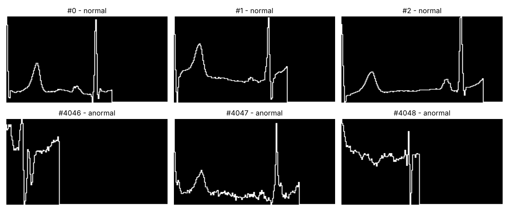
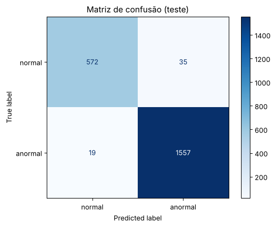

# CardioIA: Diagnóstico visual de ECG com MLP (Fase 2, Ir Além 2)

Rede neural do tipo **Perceptron Multicamadas (MLP)** em Keras que classifica batimentos de eletrocardiograma em **normal** ou **anormal** a partir de imagens.

## 👨‍🎓 Integrante

- Pedro Gustavo França Moreira (RM: 568262)

## 👩‍🏫 Professores

- Tutor(a): Sabrina Otoni
- Coordenador(a): André Godoi

## 🎥 Vídeo de demonstração

**Link (YouTube, não listado):** COLAR_LINK_AQUI

## 📊 Dataset

[ECG Heartbeat Categorization Dataset (Kaggle)](https://www.kaggle.com/datasets/shayanfazeli/heartbeat), parte **PTB Diagnostic ECG Database**:

- `ptbdb_normal.csv`: batimentos normais
- `ptbdb_abnormal.csv`: batimentos anormais
- Cada linha = 1 batimento com 187 amostras do sinal (já normalizadas de 0 a 1) + rótulo

## 🧠 Pipeline

1. **Sinal → imagem:** cada batimento é desenhado como o traçado de um ECG (linha branca em fundo preto, 128x187, tons de cinza)
2. **Pré-processamento:** redimensionamento para 32x64, normalização dos pixels para 0..1 e flatten (2.048 entradas)
3. **Divisão:** 70% treino, 15% validação, 15% teste (estratificado) + `class_weight` para compensar o desbalanceamento
4. **MLP:** Dense 256 → Dropout → Dense 128 → Dropout → Dense 64 → saída sigmoid
5. **Treino:** Adam, binary crossentropy, EarlyStopping
6. **Avaliação:** acurácia, recall, classification report, matriz de confusão e análise dos erros

## 📈 Resultados

> PREENCHER com os números do seu run

| Métrica | Valor |
|---|---|
| Acurácia (teste) | ___ |
| Recall anormais | ___ |
| Épocas até parar | ___ |

Exemplos de imagens geradas (pasta `exemplos/`):





## 🔧 Como executar

**Google Colab (recomendado):** [abrir no Colab](https://colab.research.google.com/github/pedromoreira427/cardioia-ecg-mlp/blob/main/ecg_mlp.ipynb) e use *Ambiente de execução > Executar tudo*. O notebook baixa o dataset sozinho com `kagglehub`.

Se o download automático falhar, baixe o zip no Kaggle e coloque `ptbdb_normal.csv` e `ptbdb_abnormal.csv` numa pasta `data/` ao lado do notebook.

**Local:**

```bash
pip install tensorflow pandas scikit-learn matplotlib kagglehub jupyter
jupyter notebook ecg_mlp.ipynb
```

## ⚠️ Limitações

- MLP não aproveita a vizinhança dos pixels; uma CNN tende a ser melhor para imagem.
- Batimentos de um mesmo paciente podem estar no treino e no teste, o que deixa a acurácia otimista.
- Projeto acadêmico, não usar para diagnóstico.
